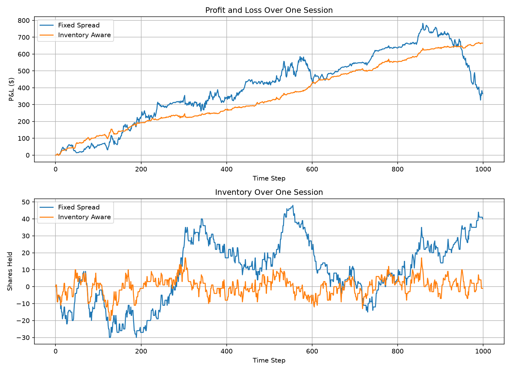

# Market-Making Simulator

A Python project where I built a simple market-making bot and tested how different quoting strategies perform in a simulated market.

## What it does

The simulator generates a random market price that changes over time, along with incoming buy and sell orders. The bot places its own bid and ask prices, executes trades when orders get filled, and keeps track of its cash and inventory.

I implemented two strategies to compare:

- **Fixed Spread:** Keeps the same distance between its bid and ask prices.
- **Inventory-Aware:** Adjusts its quotes based on how many shares it currently holds. If inventory gets too high, it shifts its prices to make selling more attractive.

## What I used

- Python
- NumPy
- Matplotlib

## Results

I ran both strategies over 100 simulated sessions, with 1,000 steps in each session.

| Metric | Fixed Spread | Inventory-Aware |
|---|---:|---:|
| Average P&L | $763.31 | $619.07 |
| Average Inventory | 24.10 | 3.96 |
| Worst Final P&L | -$603.96 | $431.21 |
| Average Maximum Drawdown | $371.17 | $35.61 |
| Worst Maximum Drawdown | $1,252.62 | $97.15 |
| Maximum Inventory | 50 | 25 |
| Losing Sessions | 5 | 0 |

The inventory-aware strategy reduced average inventory by 83.58% and average maximum drawdown by about 90.40% in these simulations. However, its average P&L was lower than the fixed-spread strategy.

I found this comparison interesting because it shows the trade-off between making profits and managing inventory risk.

## Graphs

The simulator also generates graphs to compare the P&L and inventory of both strategies over a session.



## Running the project

Clone the repository and open the project folder.

Install the required libraries:

```bash
pip install -r requirements.txt
```

Run the simulator:

```bash
python3 main.py
```

## Things I want to work on next

- Connect the simulator to my C++ limit order book and matching engine.
- Experiment with different spread and inventory settings.
- Add transaction costs and market impact.
- Test the strategies under different market conditions.

*Note: This project uses a simplified simulated market. The results are experimental and do not represent live trading performance.*